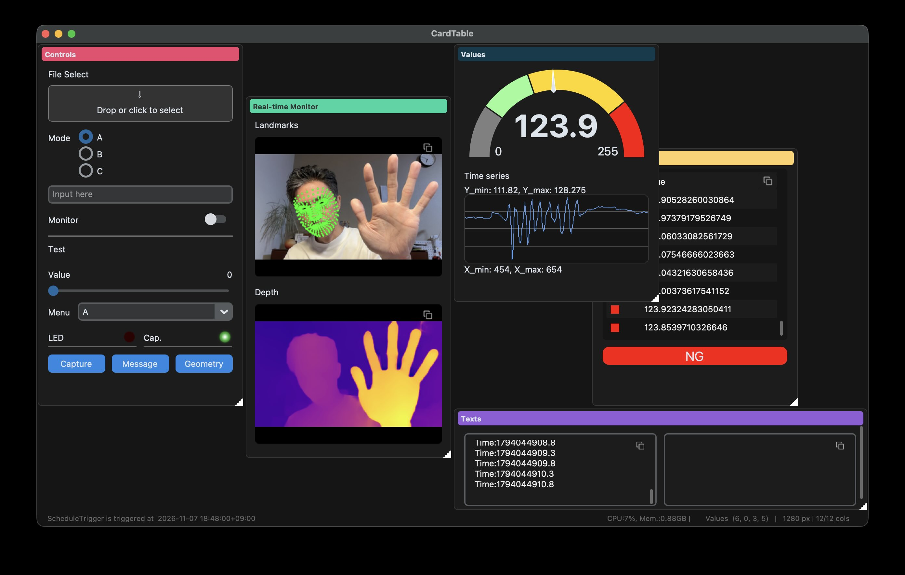

<div align="center">
An event-driven Python GUI framework with a card-based layout
</div>


## 🚀 Setup

Requires Python 3.10+ and [uv](https://docs.astral.sh/uv/getting-started/installation/).

```bash
git clone https://github.com/ikeboo/CardTable.git
cd CardTable
uv sync --locked
```

## ⚡️ Quick Start

```bash
uv run python examples/quick_start.py
```

## 🛠️ Create Your App

### 🤵‍♂️ Dealer

Subclass `Dealer` and define UI components and triggers in `setup()`, called once during initialization.

```python
import cardtable as c


class App(c.Dealer):
    def setup(self):
        with c.Card(0, 0, 4, 4, "Button"):
            c.Button("Show", self.show)

    def show(self):
        c.show_message("Hello cardtable")


if __name__ == "__main__":
    App().start()
```

### 🃏 Layout Cards & Elements

`Card(x, y, w, h, title)` sets position and size in grid units. Inside `with c.Card(...)`, elements stack in declaration order; use `with c.Row()` to arrange them horizontally.

```python
import cardtable as c


class App(c.Dealer):
    def setup(self):
        with c.Card(0, 0, 4, 4, "Hello"):
            c.Entry("Input here")
            with c.Row():
                c.Button("Run")
                c.Button("Stop")
```

| Element | Description |
| --- | --- |
| `Label` | Text label |
| `BoxedLabel` | Rounded text badge |
| `Text` | Plain text, JSON, or Markdown display |
| `Image` | Image display |
| `Table` | Tabular data display |
| `SignalPlot` | Signal plot |
| `Entry` | Text input |
| `Number` | Numeric spinbox |
| `Slider` | Numeric slider |
| `RangeSlider` | Lower and upper value selection |
| `Radio` | Radio button selection |
| `ComboBox` | Dropdown selection |
| `CheckBox` | Checkbox input |
| `Switch` | On/off switch |
| `LED` | On/off light indicator with optional input |
| `ProgressBar` | Progress display |
| `Gauge` | Numeric half-ring gauge |
| `Button` / `Btn` | Run a callback on click |
| `FileDialog` | File or directory selection dialog |
| `FileDrop` | File or directory selection by drop or dialog |
| `Separator` | Horizontal divider with an optional label |

### 🎬 Create Event Triggers

Create triggers in `setup()`. Callbacks accept no arguments or one argument annotated as `c.TriggerEvent`.

```python
import cardtable as c


class App(c.Dealer):
    def setup(self):
        self.trigger = c.TimerTrigger(100, self.on_timer)

    def on_timer(self, event: c.TriggerEvent):
        # If event parameter is added, you can get the event data.
        print(event.timestamp)
```

| Trigger | Runs on |
| --- | --- |
| `TimerTrigger` | A fixed millisecond interval |
| `ScheduleTrigger` | A cron schedule |
| `KeyTrigger` | A hotkey press |
| `FileSystemTrigger` | File or directory changes |
| `WebhookTrigger` | An HTTP POST with JSON text/image data |
| `JRPCTrigger` | A JSON-RPC request over TCP |

### Set and Get Values

Use `get()` to read an element's value and `set()` to update it.

```python
import cardtable as c


class App(c.Dealer):
    def setup(self):
        with c.Card(0, 0, 4, 4, "Text"):
            self.input = c.Entry()
            self.output = c.Text()
            c.Button("Show", self.show)

    def show(self):
        self.output.set(self.input.get())
```

### 💡 Utilities

```python
import cardtable as c


class App(c.Dealer):
    def setup(self):
        # Write log files to ./logs.
        c.set_logger("./logs")
        ...

    def your_callbak(self):
        # Show a modal message with OK and Cancel buttons.
        c.show_message("Hello")
```
